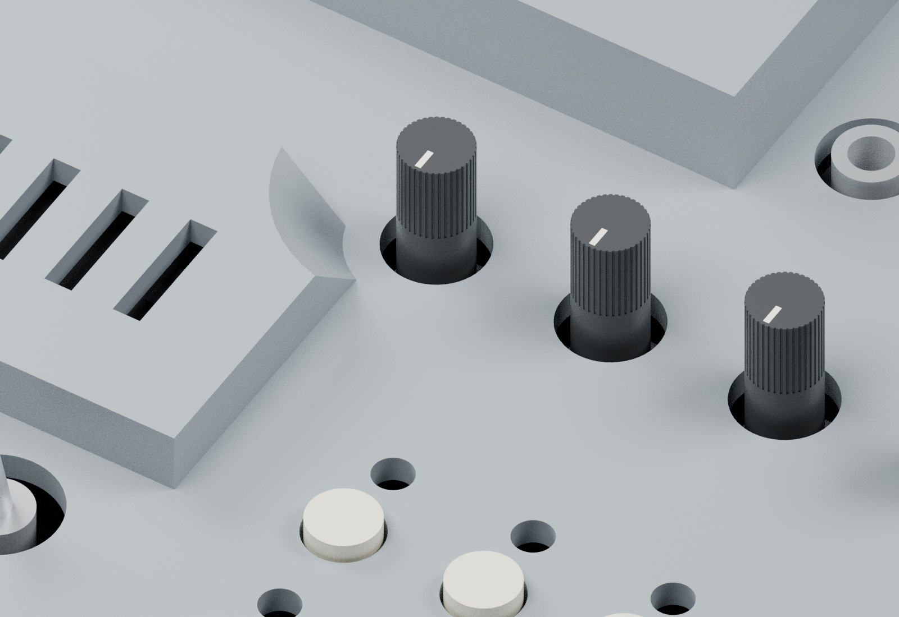
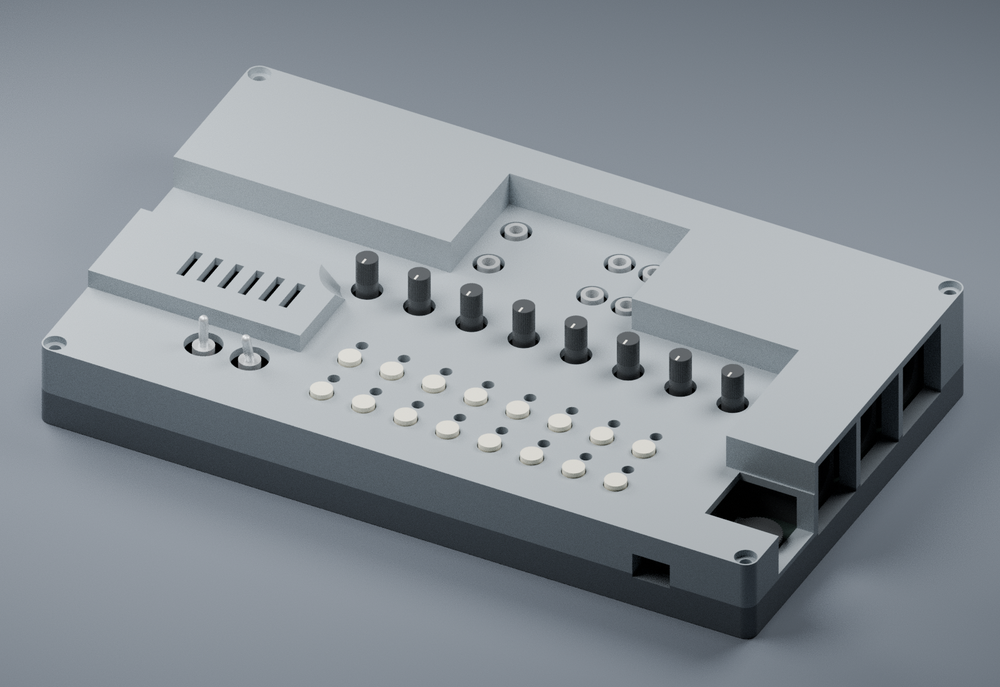

# Seed3 Desktop Dev Kit — boîtier et carte 3D

Boîtier de bureau pour le Daisy Seed3 Desktop Dev Kit, avec reconstruction mécanique de la carte équipée. Version **v2**, comprenant le dégagement corrigé du premier potentiomètre.

## Fichiers 3D

- [Assemblage complet STEP (.gz)](boitier/v2/Assemblage_Seed3_complet.step.gz) : boîtier, carte et composants nommés séparément.
- [Carte équipée STEP (.gz)](boitier/v2/Carte_Seed3_peuplee.step.gz).
- [Boîtier seul STEP](boitier/v2/Boitier_Seed3.step).
- Impression : [socle](boitier/v2/Socle.stl), [capot](boitier/v2/Capot.stl), [poussoir à imprimer 16 fois](boitier/v2/Poussoir_x16.stl).

Les deux grands STEP sont compressés en **gzip sans perte**. Télécharger le fichier brut puis le décompresser avant de l’ouvrir dans Rhino ou un autre logiciel CAO. Sur macOS : double-cliquer sur le fichier `.gz`, ou utiliser `gunzip fichier.step.gz`. Les STL et le STEP du boîtier sont directement utilisables. Toutes les unités sont en millimètres.

## Documentation et sources

- [Instructions de montage et limites du prototype](boitier/v2/LIRE_AVANT_IMPRESSION.md).
- [Dimensions déduites et précision](boitier/v2/Deduction_dimensions.md).
- [Rapport géométrique](boitier/v2/Verification_geometrie.json).
- [Sources paramétriques, KiCad/BOM et modèles utilisés](boitier/v2/Sources).
- [Instructions de régénération](boitier/v2/Sources/REGENERATION.txt).
- [Comparaison de l’implantation avec la photo](boitier/v2/Comparaison_photo_KiCad.png).
- [Contrôle des hauteurs sur la photo oblique](boitier/v2/Comparaison_photo_oblique.png).

## Révision v2

La protection du Seed3 est abaissée de 4,5 mm et son coin proche de VR1 reçoit une échancrure conique à 45°. Le dégagement latéral vers cette protection vaut 4 mm au niveau de la façade et 9,5 mm en haut. Épaisseur normale de paroi : 2,4 mm.

Enveloppe extérieure : **209 × 123 × 34 mm**. Les positions des composants et des connecteurs sont conservées. Les STL sont fermés ; aucune collision boîtier/composants n’a été détectée sur les solides modélisés. Le jeu minimal Seed3/capot calculé est de 0,975 mm.

**Prototype à valider physiquement.** Les positions XY viennent du KiCad officiel ; certaines références génériques de la BOM et certaines hauteurs ont été déduites des plans fabricants et des photographies. Le modèle ne constitue pas une métrologie certifiée de la carte réelle.

## Origines et licences

Base électronique : [daisyaudio/Seed3-DevKit-Desktop](https://github.com/daisyaudio/Seed3-DevKit-Desktop), commit `94347176c7909f41db8ab8139eb632ea7d0ecab9`. La licence du matériel d’origine et les notices disponibles sont conservées dans Sources. Les modèles fabricants conservent leurs conditions d’origine ; voir la documentation du prototype pour leur provenance.

